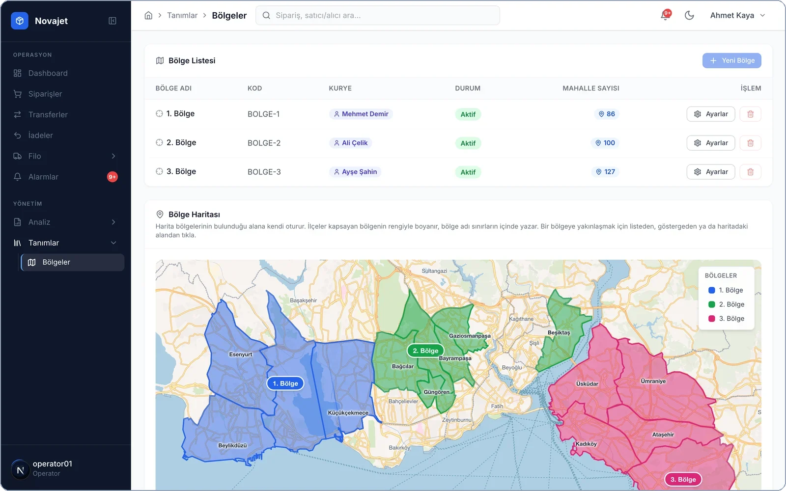
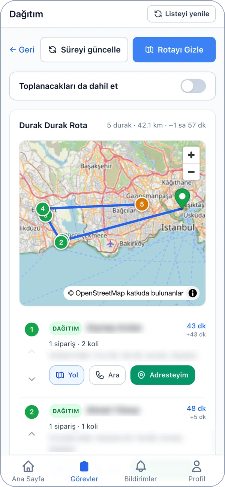
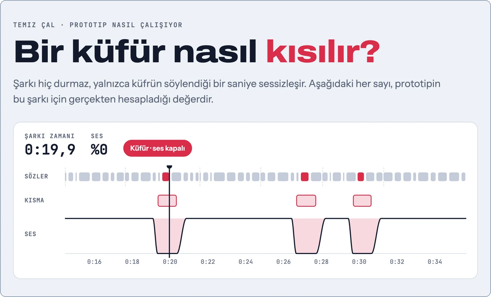
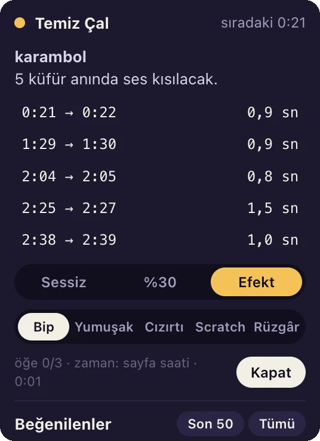
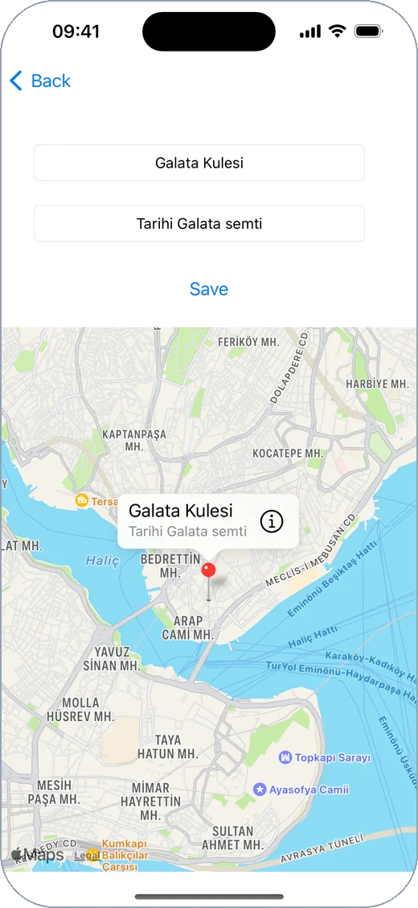
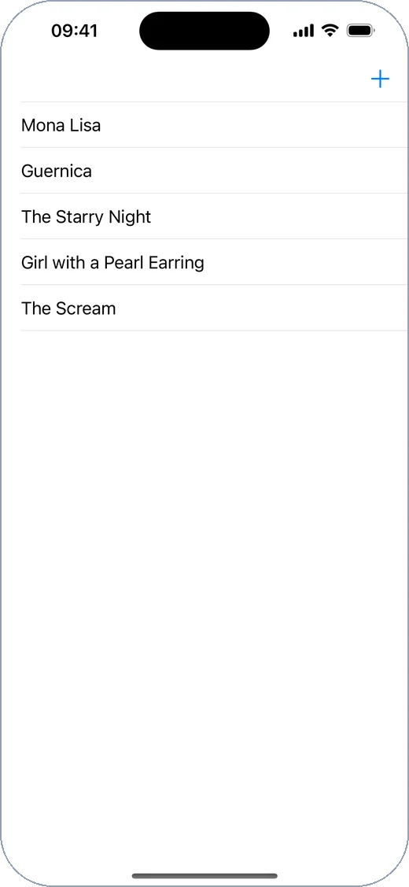
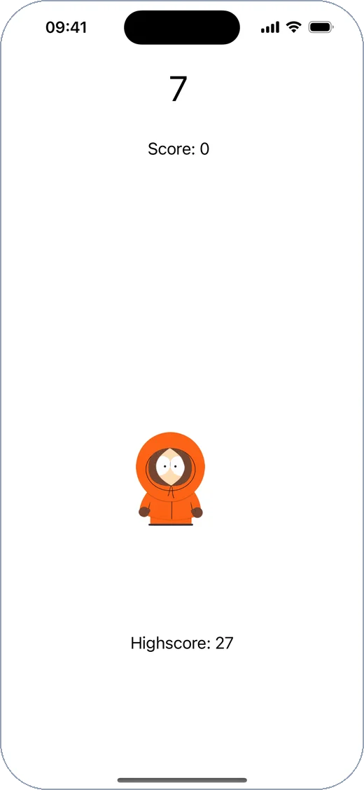
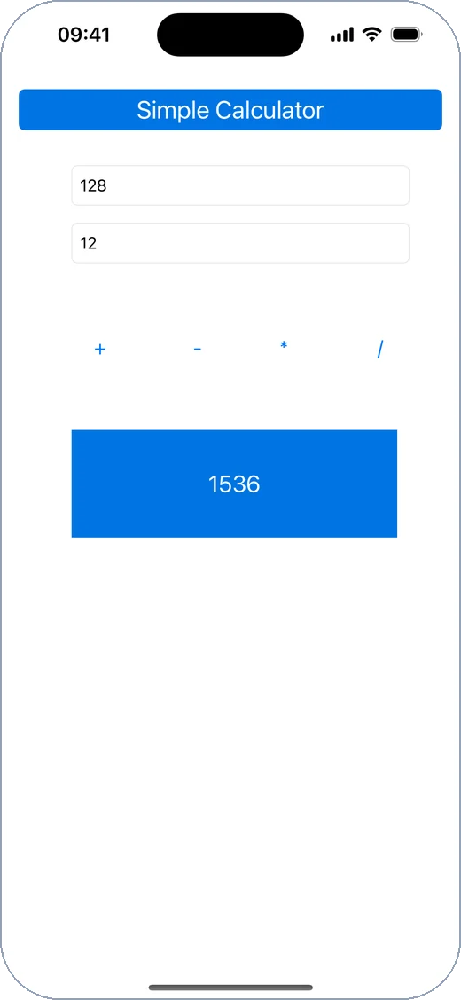

<picture>
  <source media="(prefers-color-scheme: dark)" srcset="assets/banner-dark-2.svg">
  
</picture>

 

Sipariş alımından son teslimata kadar lojistik operasyonlarını yöneten yazılımlar tasarlıyor ve geliştiriyorum. Odak alanım çok kiracılı SaaS mimarisi, rota optimizasyonu ve operasyon otomasyonu.

**Lojistik platformları** &nbsp;·&nbsp; **Rota ve kurye atama** &nbsp;·&nbsp; **Operasyon otomasyonu**

 

## Öne çıkan proje

### Novajet — Son kilometre teslimat platformu

  <picture>
    <source media="(prefers-color-scheme: dark)" srcset="assets/novajet-bolgeler-dark.webp">
    
  </picture>
  

Kargo firmalarının sipariş, kurye ve filo operasyonunu tek yerden yönettiği çok kiracılı teslimat platformu.

- **Kapasiteye dayalı kurye atama** ve sıralı sevkiyat kuyruğu
- **Rota optimizasyonu** — gerçek yol mesafesi ve saate göre trafik katsayısı
- **Canlı filo takibi**, bölge yönetimi ve kurye performans analizi
- **Kurye uygulaması (PWA)** — çevrimdışı çalışma, barkod okuma, teslim kanıtı
- **Yönetim paneli** — kiracı yaşam döngüsü, plan/modül paketleri, denetim günlüğü

**Rol:** Mimari ve full-stack geliştirme &nbsp;·&nbsp; **Teknoloji:** NestJS, Next.js, PostgreSQL/PostGIS, Redis, WebSocket &nbsp;·&nbsp; *Kaynak kodu özel*

 

## Diğer projeler

### Temiz Çal — Spotify için içerik filtresi

  
  

Spotify'da çalan şarkıyı durdurmadan, yalnızca uygunsuz sözün geçtiği anlarda sesi kısan filtre. Zaman damgalı sözlerden saniye hassasiyetinde bir kısma planı çıkarır; sözü bulunmayan şarkılar için konuşma tanıma (Whisper) ile zaman damgası üretir.

**Teknoloji:** JavaScript (Chrome uzantısı), Python, Whisper &nbsp;·&nbsp; *Geliştirme aşamasında*

 

<!-- IOS-IZGARA-BAS -->
## iOS projeleri (Swift)

<table>
  <tr>
    <td align="center" width="25%" valign="top"> <b><a href="https://github.com/ahmetuludogan/TravelBook">TravelBook</a></b> Harita ve kayıtlı yerler · MapKit, Core Data</td>
    <td align="center" width="25%" valign="top"> <b><a href="https://github.com/ahmetuludogan/ArtBook">ArtBook</a></b> Fotoğraflı kayıt defteri · Core Data</td>
    <td align="center" width="25%" valign="top"> <b><a href="https://github.com/ahmetuludogan/CatchTheKenny">CatchTheKenny</a></b> Zamanlı dokunma oyunu · Timer</td>
    <td align="center" width="25%" valign="top"> <b><a href="https://github.com/ahmetuludogan/Simple-Calculator">SimpleCalculator</a></b> Hesap makinesi</td>
  </tr>
</table>

 
<!-- IOS-IZGARA-SON -->

## Teknoloji

| Alan | Araçlar |
|---|---|
| **Backend** |             |
| **Frontend** |        |
| **Mobil** |         |
| **Diğer** |     |
| **Test** |    |
| **Altyapı** |        |

## İletişim

 

