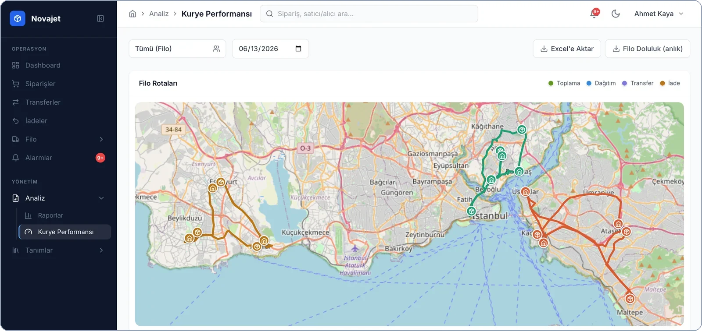
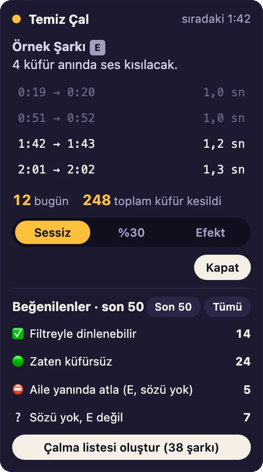
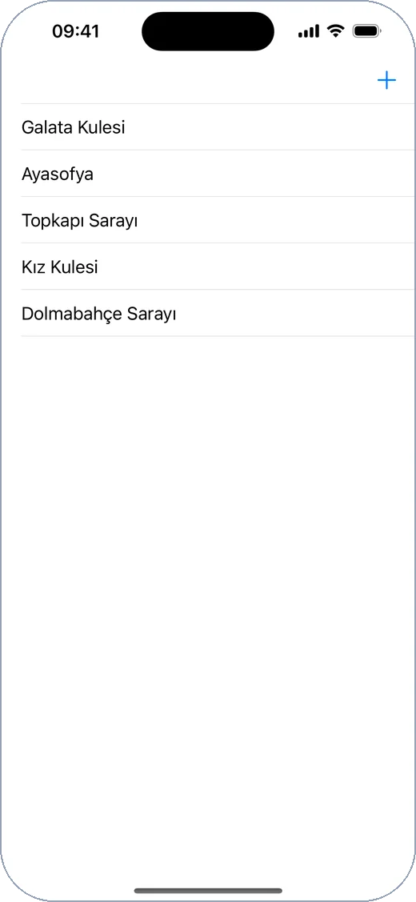

<picture>
  <source media="(prefers-color-scheme: dark)" srcset="assets/banner-dark.svg">
  
</picture>

 

Sipariş alımından son teslimata kadar lojistik operasyonlarını yöneten yazılımlar tasarlıyor ve geliştiriyorum. Odak alanım çok kiracılı SaaS mimarisi, rota optimizasyonu ve operasyon otomasyonu.

**Lojistik platformları** &nbsp;·&nbsp; **Rota ve kurye atama** &nbsp;·&nbsp; **Operasyon otomasyonu**

 

## Öne çıkan proje

### Novajet — Son kilometre teslimat platformu

<picture>
  <source media="(prefers-color-scheme: dark)" srcset="assets/novajet-bolgeler-dark.webp">
  
</picture>

  <picture>
    <source media="(prefers-color-scheme: dark)" srcset="assets/novajet-filo-dark.webp">
    
  </picture>
  

Kargo firmalarının sipariş, kurye ve filo operasyonunu tek yerden yönettiği çok kiracılı teslimat platformu.

- **Kapasiteye dayalı kurye atama** ve sıralı sevkiyat kuyruğu
- **Rota optimizasyonu** — gerçek yol mesafesi ve saate göre trafik katsayısı
- **Canlı filo takibi**, bölge yönetimi ve kurye performans analizi
- **Kurye uygulaması (PWA)** — çevrimdışı çalışma, barkod okuma, teslim kanıtı
- **Yönetim paneli** — kiracı yaşam döngüsü, plan/modül paketleri, denetim günlüğü

**Rol:** Mimari ve full-stack geliştirme &nbsp;·&nbsp; **Teknoloji:** NestJS, Next.js, PostgreSQL/PostGIS, Redis, WebSocket &nbsp;·&nbsp; *Kaynak kodu özel*

 

## Diğer projeler

### Temiz Çal — Spotify için içerik filtresi

  
  

Spotify'da çalan şarkıyı durdurmadan, yalnızca uygunsuz sözün geçtiği anlarda sesi kısan filtre. Zaman damgalı sözlerden saniye hassasiyetinde bir kısma planı çıkarır; sözü bulunmayan şarkılar için konuşma tanıma (Whisper) ile zaman damgası üretir.

**Teknoloji:** JavaScript (Chrome uzantısı), Python, Whisper &nbsp;·&nbsp; *Geliştirme aşamasında*

 

### [TravelBook](https://github.com/ahmetuludogan/TravelBook) — iOS

  
  &nbsp;
  

Gezilen yerleri haritada işaretleyip notlarıyla birlikte cihazda saklayan iOS uygulaması.

**Teknoloji:** Swift, UIKit, MapKit, Core Location, Core Data

 

## Teknoloji

| Alan | Araçlar |
|---|---|
| **Backend** |      |
| **Frontend** |    |
| **Mobil** |   |
| **Altyapı** |    |

## İletişim

 

