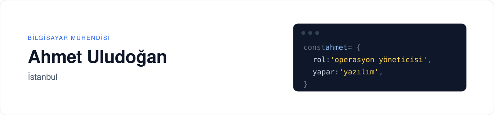

<picture>
  <source media="(prefers-color-scheme: dark)" srcset="assets/banner-dark-3.svg">
  
</picture>

 

Bilgisayar mühendisliği mezunu bir operasyon yöneticisiyim. Sahada gördüğüm ihtiyaçlardan yola çıkarak hem işimi kolaylaştıran hem de kişisel yazılımlar geliştiriyorum.

[ahmetuludogan.com](https://www.ahmetuludogan.com)

 

## Öne Çıkan Proje

### [Novajet](https://panel.novajet.co) — Teslimat Operasyon Platformu

  <a href="https://panel.novajet.co"><picture>
    <source media="(prefers-color-scheme: dark)" srcset="assets/novajet-bolgeler-dark.webp">
    
  </picture></a>
  

[Novadan](https://www.novadan.com.tr) için geliştirdiğim; sipariş, kurye ve filo operasyonunu tek yerden yöneten teslimat platformu. Novadan, İstanbul'daki kendi kurye teslimatlarını her gün Novajet üzerinden yönetiyor.

- **Kapasiteye dayalı kurye atama** ve sıralı sevkiyat kuyruğu
- **Rota optimizasyonu** — gerçek yol mesafesi ve saate göre trafik katsayısı
- **Canlı filo takibi**, bölge yönetimi ve kurye performans analizi
- **Kurye uygulaması (PWA)** — çevrimdışı çalışma, barkod okuma, teslim kanıtı
- **Yönetim paneli** — kiracı yaşam döngüsü, plan/modül paketleri, denetim günlüğü

**Rol:** Ürün sahibi ve geliştirici &nbsp;·&nbsp; **Teknoloji:** NestJS, Next.js, PostgreSQL/PostGIS, Redis, WebSocket &nbsp;·&nbsp; *Kaynak kodu özel* &nbsp;·&nbsp; [panel.novajet.co](https://panel.novajet.co)

 

## Diğer Projeler

### Temiz Çal — Spotify'da Uygunsuz Sözleri Susturan Filtre

  
  

Spotify'da çalan şarkıyı durdurmadan, yalnızca uygunsuz sözün geçtiği anlarda sesi kısan filtre. Zaman damgalı sözlerden saniye hassasiyetinde bir kısma planı çıkarır; sözü bulunmayan şarkılar için konuşma tanıma (Whisper) ile zaman damgası üretir.

**Teknoloji:** JavaScript (Chrome uzantısı), Python, Whisper &nbsp;·&nbsp; *Geliştirme aşamasında*

 

<!-- IOS-IZGARA-BAS -->
## iOS Projeleri (Swift)

<table>
  <tr>
    <td align="center" width="25%" valign="top"> <b><a href="https://github.com/ahmetuludogan/TravelBook">TravelBook</a></b> Harita ve kayıtlı yerler · MapKit, Core Data</td>
    <td align="center" width="25%" valign="top"> <b><a href="https://github.com/ahmetuludogan/ArtBook">ArtBook</a></b> Fotoğraflı kayıt defteri · Core Data</td>
    <td align="center" width="25%" valign="top"> <b><a href="https://github.com/ahmetuludogan/CatchTheKenny">CatchTheKenny</a></b> Zamanlı dokunma oyunu · Timer</td>
    <td align="center" width="25%" valign="top"> <b><a href="https://github.com/ahmetuludogan/Simple-Calculator">SimpleCalculator</a></b> Hesap makinesi</td>
  </tr>
</table>

 
<!-- IOS-IZGARA-SON -->

## Teknoloji

<table>
  <tr><td width="110"><b>Backend</b></td><td>TypeScript · Node.js · NestJS · Prisma · PostgreSQL / PostGIS · Redis · Socket.IO · Swagger (OpenAPI)</td></tr>
  <tr><td width="110"><b>Frontend</b></td><td>Next.js · React · Tailwind CSS · TanStack Query · MapLibre</td></tr>
  <tr><td width="110"><b>Mobil</b></td><td>Swift · UIKit · MapKit · Core Data · PWA</td></tr>
  <tr><td width="110"><b>Diğer</b></td><td>Python · Whisper · JavaScript · Chrome uzantısı</td></tr>
  <tr><td width="110"><b>Test</b></td><td>Jest · Vitest · Playwright</td></tr>
  <tr><td width="110"><b>Altyapı</b></td><td>Docker · GitHub Actions · PM2 · Linux · Turborepo</td></tr>
</table>
